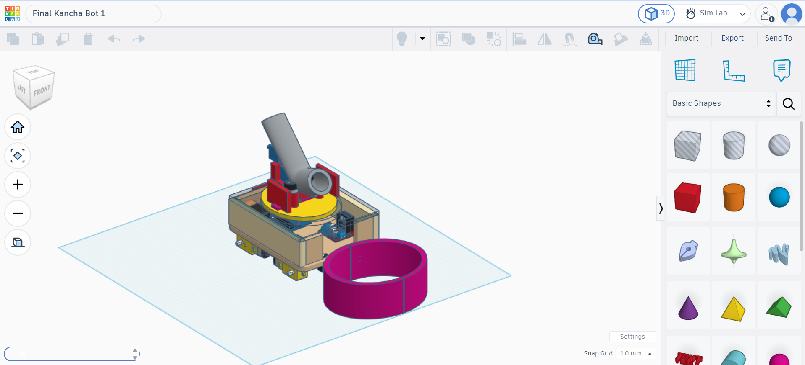

# 🤖 Kancha Bot: Delhi Robotics League

Our robot for the **Delhi Robotics League (DRL)**, a school-level robotics competition inspired by DD Robocon. This repository documents the design, electronics, code, bill of materials, and lessons we learned while building and competing with **Kancha Bot**.

---

## 📑 Table of Contents

- [Demo Video](#-demo-video)
- [Team](#-team)
- [What is the Delhi Robotics League?](#-what-is-the-delhi-robotics-league)
- [Inspired by DD Robocon](#-inspired-by-dd-robocon)
- [Our Robot: Kancha Bot](#-our-robot-kancha-bot)
- [CAD Design](#-cad-design)
- [Bill of Materials (BOM)](#-bill-of-materials-bom)
- [Repository Structure](#-repository-structure)
- [Getting Started](#-getting-started)
- [Challenges & Learnings](#-challenges--learnings)
- [Acknowledgements](#-acknowledgements)
- [License](#-license)

---

## 🎥 Demo Video

**Watch IAS Himanshu Gupta Sir try Kancha Bot:** [Watch the robot demonstration](https://drive.google.com/file/d/1_SxmUtC7Sb9xPgpGx0uNdIp6EL1kQ1fR/view?usp=drive_link)

>
> ``

During the event, we had the opportunity to present our robot to **IAS Himanshu Gupta, Atishi, former Delhi Chief Minister Arvind Kejriwal, and IIT professors**. The video shows IAS Himanshu Gupta trying the robot and seeing how it works.

---

## 👥 Team


*Our team with our mentor and Kancha Bot.*

| Name | Role | Responsibilities
|---|---|
| Piyush | TL, Robotics & Electronics Integration |  Electronics Integration

Coordinating hardware integration, troubleshooting electrical issues, and helping rebuild the robot under competition deadlines
| Gurmeet Singh | Mechanical Design & Chassis | Chassis construction, structural assembly, and mechanical stability.
| Ashmit Raj Nishad | Shooting Mechanism Engineer | Assembly, alignment, and adjustment of the shooting mechanism and motors.
| Lavish | Arduino & Embedded Systems | Arduino programming, motor-control logic, and electronics debugging.
| Chirag | Remote Control & Communication | Remote-control integration and wireless communication between the controller and robot
| Gaurav Joshi | Power Systems & Wiring | Battery management, power distribution, wiring, and electrical connections.
| Vainessa Sharma | Testing & Quality Assurance | Practice testing, identifying performance issues, and checking robot functionality before matches.

**Team:** TECH-DECODERS  
**Mentor:** Mr. Shubham Jain  
**School:** DBRA SOSE, Sector 11, Rohini, Delhi

---

## 🏆 What is the Delhi Robotics League?

The **Delhi Robotics League (DRL)** is a robotics competition for school students in Delhi. The competition gives students hands-on experience in designing, building, programming, testing, and operating robots to complete a defined challenge.

Our robot was built for the **Robo Kancha** challenge, inspired by the traditional game of *kancha* (marbles). Building the robot required mechanical design, electronics, motor control, troubleshooting, and teamwork under competition time constraints.

---

## 🌏 Inspired by DD Robocon

The Delhi Robotics League draws inspiration from the build-test-compete approach of robotics competitions such as **DD Robocon**. Like other robotics challenges, DRL encouraged us to turn a design into a working machine, test it under pressure, and make practical improvements when problems appeared.

---

## 🛠️ Our Robot: Kancha Bot

**Kancha Bot** was designed and built by Team TECH-DECODERS for the Delhi Robotics League. It combines a mobile chassis, mecanum wheels, a wireless remote-control system, and a motor-driven shooting mechanism. The robot uses Arduino boards for control and DC motors for movement and shooting.

The build was an iterative process: we assembled and tested the robot, made last-minute changes before matches, and repaired or adjusted components when real competition conditions exposed weaknesses.

### Specifications

| Parameter | Value |
|---|---|
| Overall dimensions (L × W × H) | Approximately 485 × 485 × 800 mm |
| Approximate weight | 20 kg |
| Drive wheels | 4 mecanum wheels |
| Main controller | Arduino Mega (ATmega2560) |
| Remote controller | Arduino Nano (ATmega328P) |
| Wireless communication | NRF24L01+ PA/LNA modules |
| Drive motors | 4 BO motors, listed as 500 RPM |
| Shooting mechanism | 2 RS-555 DC motors and 2 shooting wheels |
| Chassis / structural material | Includes plywood/fibre circular disc and metal chassis components, as documented in the BOM |

---

## 📐 CAD Design

🔗 **CAD model link:** [CAD LINK](https://www.tinkercad.com/things/iN1c5valeRQ-final/edit?sharecode=2Y9eHm3tryb3fXrdfdQPKgWki3Zt0JGxeXu6Aq2MZfY)

CAD source files, if included, should be placed in the [`cad/`](cad/) folder.



---

## 📦 Bill of Materials (BOM)

The following BOM is based on the team's design-requirement document and its additional-parts list. Costs are the amounts recorded in that document; prices may vary by supplier and date.

### Main Components

| # | Component | Model / Specification | Qty | Recorded total cost |
|---:|---|---|---:|---:|
| 1 | Arduino Mega | ATmega2560 | 1 | ₹1,700 |
| 2 | Arduino Nano | ATmega328P | 1 | ₹2,919 |
| 3 | NRF transceiver modules | NRF24L01+ PA/LNA | 1 Tx + 1 Rx | ₹369 |
| 4 | Motor drivers | L298N | 3 | ₹873 |
| 5 | BO motors | Single shaft, 500 RPM | 4 | ₹220 |
| 6 | RS-555 DC motors | 12 V, listed as 5,000 RPM | 2 | ₹440 |
| 7 | Servo motor | MG995 | 1 | ₹275 |
| 8 | Servo motors | SG90 | 3 | ₹320 |
| 9 | Joystick modules | HW-504 dual-axis XY | 2 | ₹200 |
| 10 | Potentiometer | 10 kΩ | 1 | ₹100 |
| 11 | Tactile push buttons | 6 × 6 × 5 mm | 4 | ₹70 |
| 12 | Shooting wheels | 7 cm diameter | 2 | ₹100 |
| 13 | LiPo batteries | 12 V, 1100 mAh | 3 | ₹540 |
| 14 | BO motor mounting clampers | — | 4 | ₹200 |
| 15 | Plywood/fibre circular disc | 35 cm diameter, 1.5 cm thick | 1 | ₹900 |
| 16 | Zero PCB | 9 × 15 cm | 3 | ₹300 |
| 17 | Chassis material | Aluminium or steel, listed as 500 × 500 mm | 4 | ₹940 |
| 18 | Jumper wires | Assorted, 2 packs | 2 packs | ₹200 |
| 19 | Mecanum wheels | 7.5 mm listed in source document | 4 | ₹800 |
| 20 | PVC pipe | 16 cm diameter × 70 cm length | 1 | ₹1,000 |
| 21 | Zip ties | 10 inch | 20 | ₹100 |
| 22 | Switch buttons | 12–24 V | 2 | ₹120 |
|  | **Main BOM subtotal (as recorded)** |  |  | **₹12,686** |

### Additional Parts and Workshop Supplies

| # | Component | Specification / Purpose | Qty | Recorded total cost |
|---:|---|---|---:|---:|
| 1 | Arduino Nano cable | USB Mini-B, for uploading code | 1 | ₹40 |
| 2 | Arduino Mega cable | USB Type-A to Type-B, for uploading code | 1 | ₹40 |
| 3 | Red and black wire | 2 m each, 22–25 AWG, motor connections | 2 packs each | ₹500 |
| 4 | DC motor mounting clampers | For mounting motors to the circular disc | 2 | ₹40 |
| 5 | PVC electrical insulation tape | Electrical insulation | 1 | ₹20 |
| 6 | Rubber sheet pad | 500 × 500 mm, between frame sections | 1 | ₹150 |
| 7 | Nuts, bolts and washers | 8 mm bolt length, 3 mm diameter as listed | 2 packs | ₹90 |
| 8 | Tapping wood screws | 50 × 8 mm, frame connections | 2 packs | ₹90 |
| 9 | Aluminium sheet | 500 × 500 mm, shooting frame | 4 | ₹940 |
| 10 | LiPo charger | 12 V RC Pro Compact | 1 | ₹350 |
|  | **Additional-parts subtotal (as recorded)** |  |  | **₹2,260** |
|  | **Combined recorded total** | Main BOM + additional parts |  | **₹14,946** |

---

## 📁 Repository Structure

```text
kancha-bot-delhi-robotics-league/
├── cad/        # CAD files and design models
├── codes/      # Robot firmware and code
├── docs/       # Design documents, wiring notes and reports
├── images/     # Team photos, robot photos, CAD renders and thumbnails
├── README.md
├── LICENSE
└── ...
```

| Folder | Contents |
|---|---|
| `cad/` | CAD models and source design files, if available |
| `codes/` | Arduino firmware and controller code |
| `docs/` | Supporting design documents, wiring notes and reports |
| `images/` | Team and robot photos, renders, and video thumbnail |

---

## 🚀 Getting Started

### Hardware

1. Review the BOM and mechanical design documents.
2. Assemble the chassis, mecanum drive, and shooting mechanism.
3. Connect the controller, motor drivers, wireless modules, and power supply according to your wiring documentation.
4. Check wiring, polarity, and power connections before turning the robot on.
5. Test drive motors and the shooting mechanism separately before a full run.

### Software

1. Open the Arduino source files from [`codes/`](codes/) in the Arduino IDE or the tool used by your team.
2. Install any libraries required by the source code.
3. Select the correct board and port for the Arduino Mega or Nano.
4. Upload the appropriate firmware to each board.
5. Test the remote-control connection and each mechanism before practice or competition.

> The exact code filenames, required libraries, and wiring diagram should be added to this repository if you want other teams to reproduce the build reliably.

---

## 💡 Challenges & Learnings

The biggest lessons came from the moments when the robot had to work under real competition conditions. We learned that a robot is not finished just because it works during a test: it also needs to be repairable, stable, and ready to run repeatedly on a tight schedule.

### 1. Last-minute changes and rebuilding before a match

We had to make last-minute changes and rebuild parts of the robot before matches. Since match slots were scheduled one after another, there was very little time to troubleshoot. This taught us to stay calm, divide tasks across the team, prioritize essential repairs, and check the robot systematically before returning to the field.

### 2. Arduino Mega short circuit during a practice match

During a practice match, our Arduino Mega short-circuited. We had to disconnect the connections, remove the wiring, and rebuild the setup before the next match slot. It was a stressful reminder that a single electrical fault can stop the entire robot. We learned the importance of checking wiring carefully, inspecting power connections, and leaving time for safe testing after reassembly.

### 3. Battery drain during back-to-back final matches

During the finals, we had back-to-back matches, and our batteries drained. As the available power dropped, the shooting motors lost performance and we could not shoot as effectively as we wanted. We urgently ordered a power bank through Blinkit at the stadium and added it as an additional power source to help us continue. This experience taught us to plan for power consumption, monitor battery condition, and test the power system under repeated match conditions. A power bank should only be connected to a suitable, compatible power path—not directly to a motor supply unless the voltage and current requirements are properly handled.

### 4. Fixing shifted shooting motors with a practical adjustment

After several matches, the shooting motors had shifted slightly because the mounting structure included plywood, which allowed some movement under repeated use. We improvised by fitting an elastic rubber band—the type commonly used as a friendship band—around the shooting wheels to help adjust and stabilize their contact. It was a quick, on-the-spot fix that helped us keep going. We also learned that a permanent design should use stronger motor mounts, better alignment, and a way to prevent loosening during repeated impacts and vibration.

### 5. Presenting our robot to guests and experts

We had the opportunity to present Kancha Bot in front of **IAS Himanshu Gupta, Atishi, former Delhi Chief Minister Arvind Kejriwal, and IIT professors**. Seeing people try the robot was a memorable part of the experience. It reminded us that engineering is not only about building a mechanism; it is also about explaining how it works, demonstrating it clearly, and learning from the questions and reactions of others.

### What we took away

- **Test under realistic conditions:** repeated matches expose problems that a short bench test may not reveal.
- **Prepare for quick repairs:** keep tools, spare wires, fasteners, and essential components ready.
- **Treat electrical safety seriously:** check wiring and power connections before switching on the system.
- **Plan the power budget:** battery capacity and motor performance matter throughout the competition, not just at the start.
- **Build for mechanical rigidity:** secure motor mounts and wheel alignment are essential for consistent shooting.
- **Work as a team under pressure:** clear task division and calm troubleshooting help when match slots are limited.

---

## 🙏 Acknowledgements

We thank:

- The **Delhi Directorate of Education** and the **Delhi Board of School Education** for organizing the Delhi Robotics League.
- **IHFC (I-Hub Foundation for Cobotics), IIT Delhi**, for its role in supporting robotics learning and mentorship.
- Our mentor, **Mr. Shubham Jain**, our school **Dr. B. R. Ambedkar School of Specialilzed Excellence**, our teammates, and our families for their support.
- The event organizers and guests who gave us the opportunity to demonstrate our robot and learn from the experience.

---


## 📄 License

This project is proudly open-sourced under the **MIT License**. You are free to use, modify, distribute, and commercialize the software code, provided you include the original copyright and license notice. See the [`LICENSE`](LICENSE) file for more details.

The MIT License applies to the project's software code. Hardware designs, CAD files, documentation, images, and videos may have separate ownership or licensing terms. Please respect the rights of the original creators and obtain permission where required.

### 🙌 Acknowledgements

A massive thank you to:

- The **Delhi Robotics League** organizers for providing the opportunity to design, build, and showcase our robotics project.
- Our teammates for their collaboration, problem-solving, and dedication throughout the design, assembly, testing, and competition stages.
- The mentors, faculty members, and supporters who encouraged us throughout this journey.
- The open-source robotics community for the inspiration, resources, and knowledge that helped us learn and improve.

### 💡 What We Learned

Building Kancha Bot taught us valuable lessons in robotics, teamwork, and real-world problem-solving. From troubleshooting an electronics failure during practice to improving the shooting mechanism and managing battery performance during consecutive matches, every challenge helped us become better engineers.

We also had the opportunity to showcase our robot in front of distinguished guests, officials, and professors, making this an unforgettable learning experience.

### 🤝 Contributions

Contributions, suggestions, and improvements are welcome! Feel free to explore the repository, learn from the implementation, and contribute where appropriate.

Built with dedication by **[piyushops01](https://github.com/piyushops01) and the Team TECH - DECODERS**.

---

*Built by Team TECH-DECODERS for the Delhi Robotics League. This project represents our team's design, teamwork, experimentation, and practical learning through competition.*
